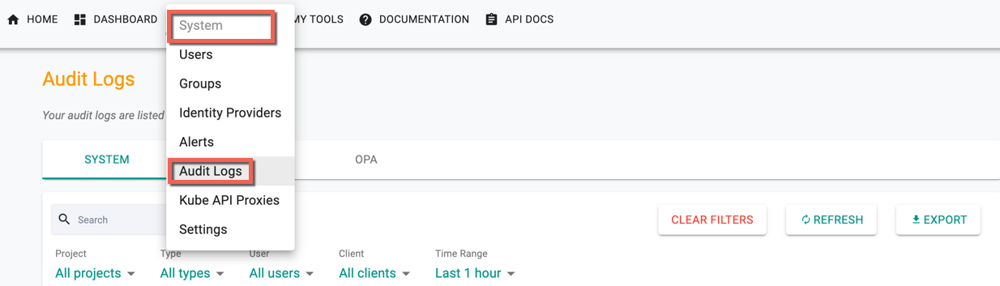
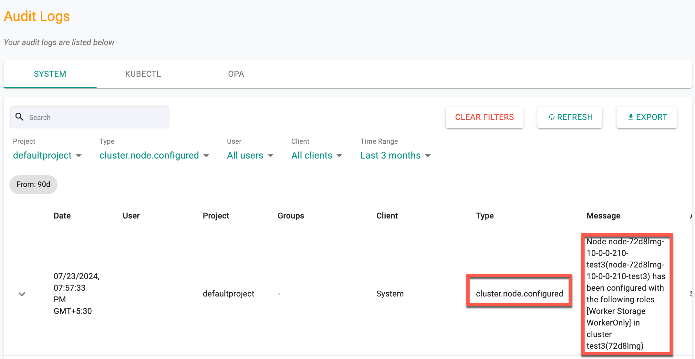
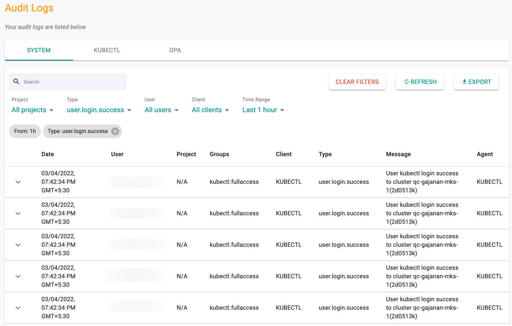
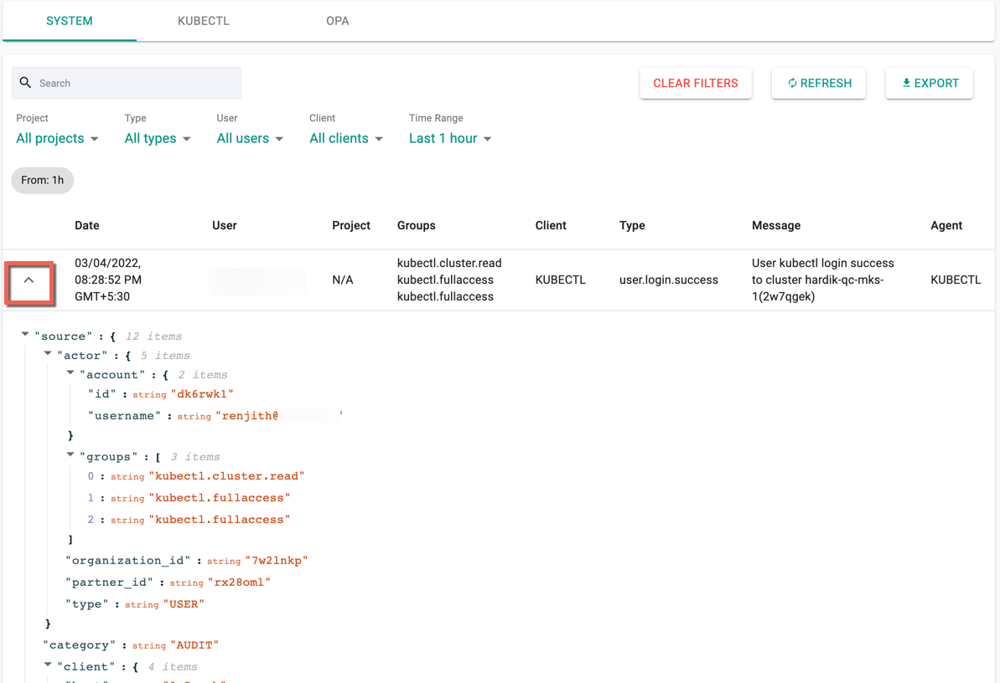
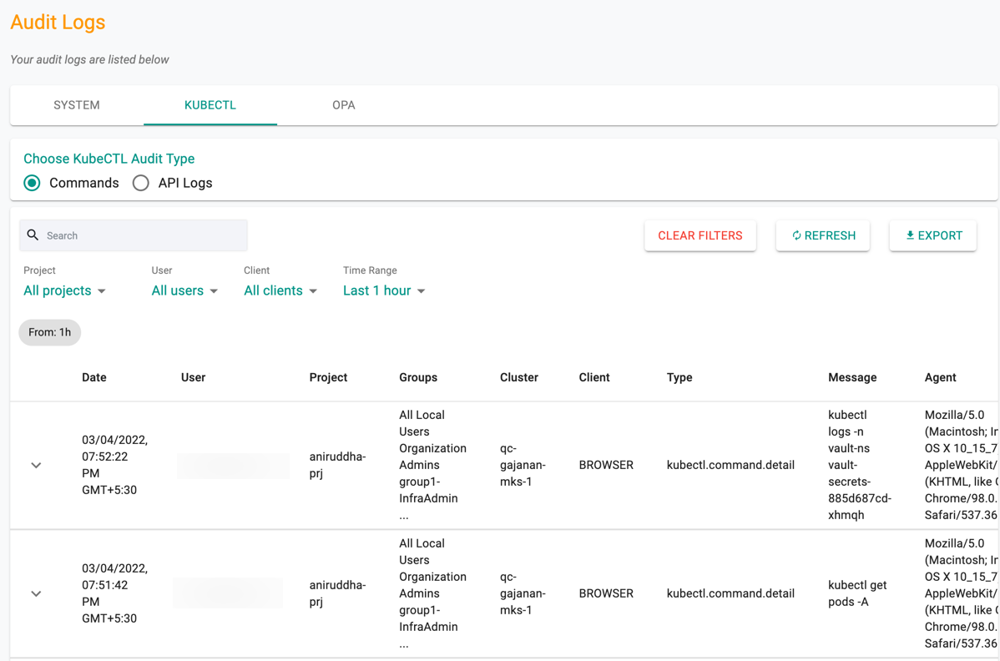
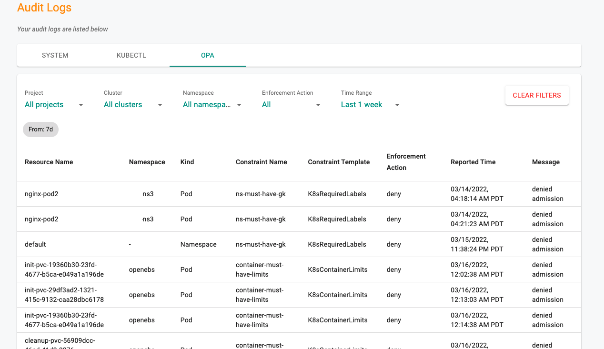

## Viewing Audit Logs

Audit logs provide a chronological record of all activities performed by authorized users in the organization.  
Users can view logs but cannot delete them.

- Navigate to **System → Audit Logs** to access logs.

---

## System Logs

System logs contain the entire history of actions in the organization. Logs are sorted by date/time (latest first).  

---

## Node Event Logs

Node lifecycle events such as DISCOVERED, APPROVED, REJECTED, DELETED, REDISCOVERED, CONFIGURED, and PROVISIONED are captured in the audit logs. Each entry includes timestamp, node name/ID, cluster, event type, and message.  

***Example***

**CONFIGURED:**  
- Type: `cluster.node.configured`  
- Message: Node `<node name or id>` in cluster `<cluster name>` configured with roles.

---

## Filters

Use canned filters to quickly retrieve required data:  

- Project  
- Action type  
- User  
- Client type (Browser, CLI, KUBECTL)  
- Time range  

Logs can also be expanded to view complete JSON payload.  

---

## KUBECTL Logs

Displays history of `kubectl` commands and API calls.  

Options:  
- **Search** logs  
- **Clear Filters** to reset view  
- **Refresh** for latest logs  
- **Export** logs in CSV  

---

## OPA Logs

OPA Gatekeeper audit logs list resource violations against configured policies. Filter by project or cluster.  

---

## Export to SIEM

Audit logs (system, kubectl, OPA) can be streamed to a corporate SIEM for centralized monitoring.  
See [SIEM Integration](./siem/overview.md) for configuration.

---

## Retention

Audit logs are retained for **365 days** (one calendar year).
