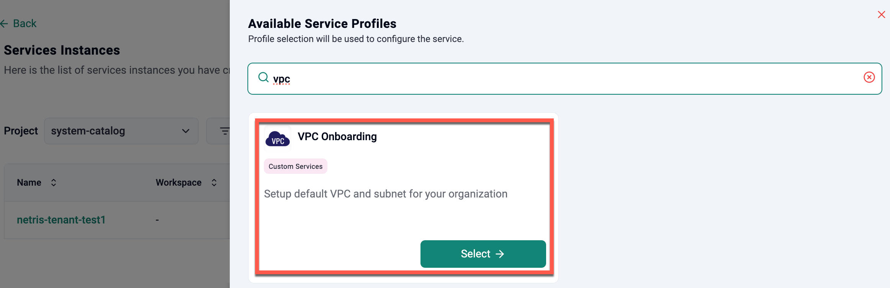
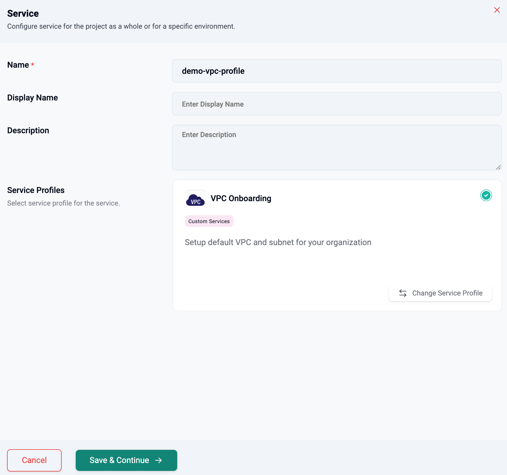
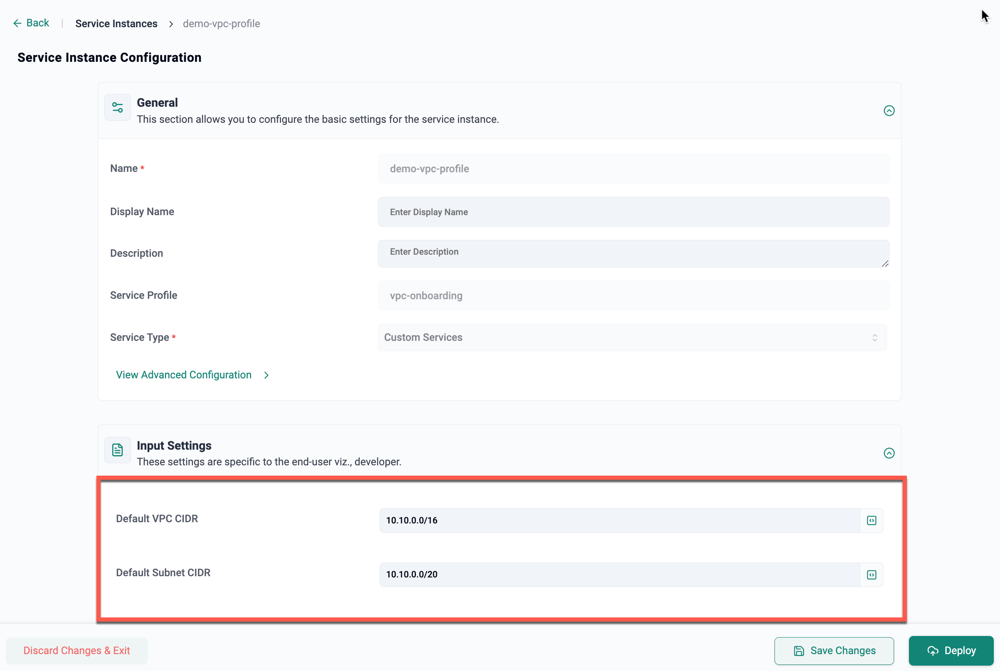
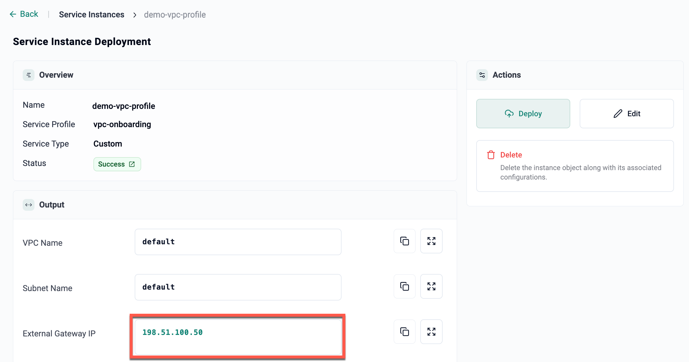
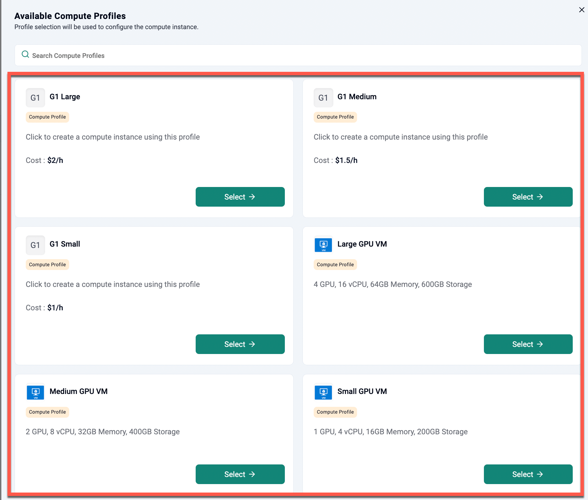
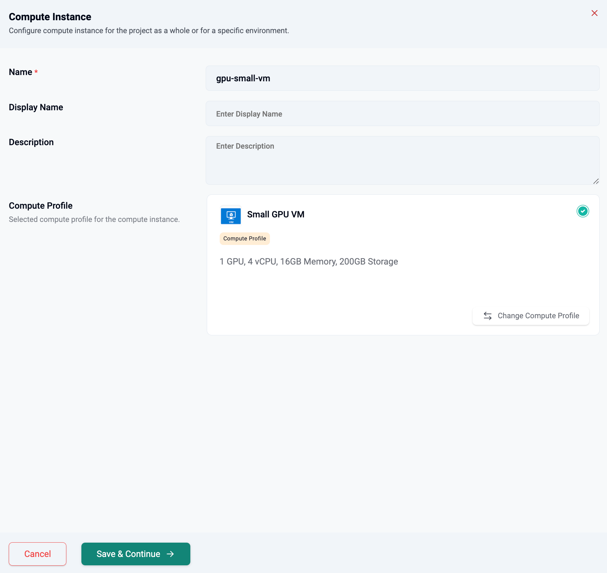
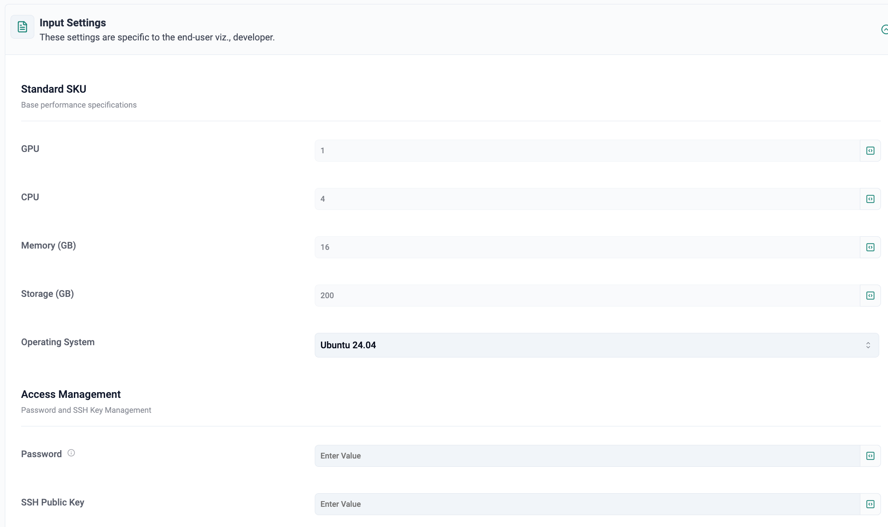

## Tenant Onboarding

When the partner is onboarding a tenant (organization), a default VPC and a default subnet are automatically created for the tenant. The end-user may optionally provide a CIDR for both the default VPC and the default subnet during this process.

The default VPC acts as the logical isolation boundary, while the default subnet provides initial network connectivity for workloads.

### Default VPC and Default Subnet Creation Flow

The following steps illustrate how the platform provisions the network infrastructure for a new tenant:

1. Reserve a public IP address from the IPAM system for this partner
2. Reserve a management IP address from the IPAM system for this partner
3. Identify the appropriate NFV host to place the VRF VM
4. Create a VPC in the backend using the reserved information
5. Create a subnet in the backend, which also reserves a VLAN
6. Create the bridge and VLAN interface for the subnet on the selected NFV host
7. Deploy the VRF VM on the NFV host using `cloud-init` commands

> **Note**:
> - Currently, only the default VPC and default subnet are created during tenant onboarding  
> - The system design supports the creation of additional subnets within the VPC and additional VPCs within the tenant

### Creating a New Service Instance in GPU PaaS Studio

Once the setup is complete, the tenant can log in to the controller and navigate to **GPU PaaS Studio → Service Instances** to provide the required details.

- Click **New Service Instance** and select a service profile. In the example below, the **VPC Onboarding** profile (shared by the Org Admin with this specific Org) is selected

- Enter a name. Optionally, provide a **Display Name** and **Description**, then click **Save & Continue**.

- Provide the `Default VPC CIDR` and `Default Subnet CIDR`

> **Note:** The subnet CIDR must be a subset of the VPC CIDR, meaning the VPC CIDR block should be larger. This is required for correct gateway assignment and IP address management during tenant VPC and subnet creation.

- Click **Deploy**

Once the deployment is complete, the following output appears, showing the VPC and Subnet names along with the `External Gateway IP`. This public gateway interface refers to the public-facing gateway used by tenant VMs to access external networks. It enables outbound connectivity and allows VMs to communicate with services outside the private network.

> **Note:** If the user already has an existing public IP assigned, this external gateway IP will override the existing public IP.

---

## Node Onboarding

Node onboarding involves preparing a physical or virtual host to be part of the infrastructure inventory. The following steps summarize the provisioning flow:

1. **Fetch Node Configuration:** Retrieve CPU, memory, and GPU topology details to determine the hardware capabilities of the node.

2. **Disk Setup Decision:**  
    - If a remote disk is required, configure an RBD (RADOS Block Device) target.
    - If not, fetch local disk details directly from the host.

3. **Install Required Packages:** Install essential system and platform-specific packages required for node functionality.

4. **Setup Host GPU Configuration:** Detect and configure GPU hardware, if present, to enable GPU-based workloads.

5. **Add Node to Inventory:** Finalize the onboarding process by registering the node in the system inventory.

>**Note:** The node is added to the system’s hardware inventory, which tracks CPU, memory, storage, and GPU availability for scheduling decisions.

---

## VM Deployment

Once the Tenant Onboarding is completed, navigate to Compute Instances from the GPU PaaS Studio and click on **New Compute Instance**.

- Select the required compute profile from the list. The example below shows the `Small GPU VM` compute profile selected.

Multiple compute profiles are available by configuring different sets of resource parameters for each profile. This is achieved by:
  1. Freezing specific field values in each profile
  2. Varying parameters like CPU, memory, storage, and others to define different sizes such as Small, Medium, or Large

- Provide a name and optionally, enter a display name and description and click **Save & Continue**

The Standard SKUs are locked and available for use, but they can be modified based on the requirements defined in the respective [Compute Profile](../gpupaas/administration/compute_profile.md).

- Provide the Access Management information, including the **Password** and **SSH Public Key**, as shown below:

- Under the Network Management, specify the Public IP Address
- By default, firewall rules at the VM level are configured to allow Port 22 from source CIDR 0.0.0.0/0, making it accessible from any IP address
    - **Destination Port:** Ports open for access (ex: `22`) (for SSH access)
    - **Protocol:** `tcp` or `udp`
    - **Rule Type:** `Allow` or `Deny` the traffic
    - **Source CIDR:**: `0.0.0.0/0`
- If **`No Public IP`** is selected under **Public IP Address**, configure **Port Forwarding** with the following settings:
    - **Protocol:** `tcp` or `udp`
    - **Destination Port:** Choose a lower-numbered external port (e.g., `2022`) and forward it to port `22` of the VM.
    This setup enables SSH access to the VM via the forwarded port on the gateway IP.
- Click **Deploy**

---
